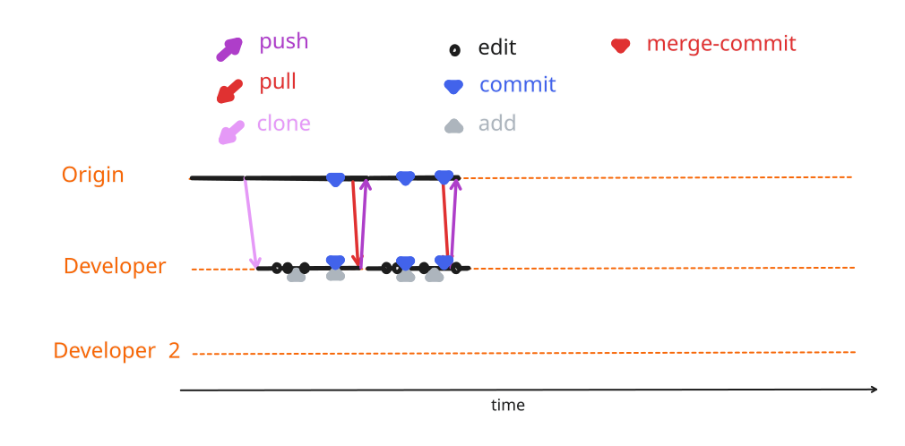


```{include} ./_status_heading_style.inc
```

### <span class="update-cycle-status">2{octicon}`sync;0.8em`/ 0{octicon}`sync;0.8em`</span>



::::{margin}



:::{card} Developer 1
- performs the 2nd update cycle
:::
:::{card} 😴 Developer 2 😴
:::

::::


