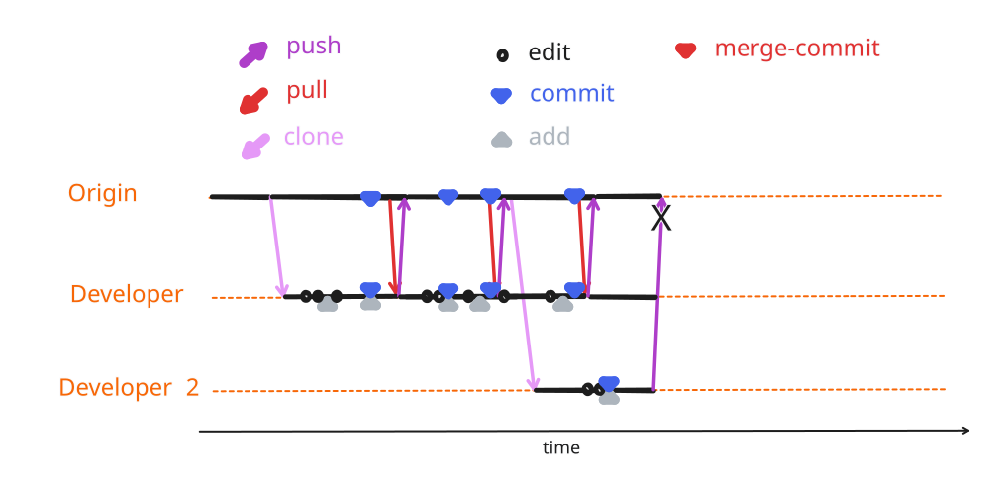


```{include} ./_status_heading_style.inc
```

### <span class="update-cycle-status">3{octicon}`sync;0.8em`/ 0.2{octicon}`sync;0.8em`</span>



:::::{margin}



::::{card} Developer 1
- performed the 3rd update cycle
::::
::::{card} Developer 2
- tries to push local changes to `origin`
:::{admonition} `push rejected`
:class: danger
Changes from `origin` were not included
:::
::::

:::::


