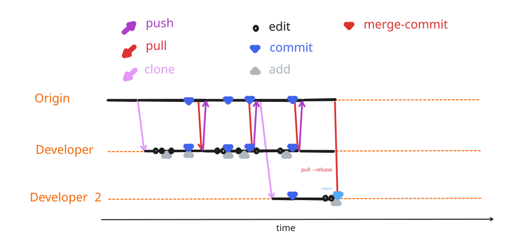


```{include} ./_status_heading_style.inc
```

### <span class="update-cycle-status">3{octicon}`sync;0.8em`/ 0.3{octicon}`sync;0.8em` - `rebase`</span>



::::{margin}



:::{card} 😴 Developer 1 😴
:::
:::{card} Developer 2
- rebases the local branch onto the state of `origin`
:::

::::


